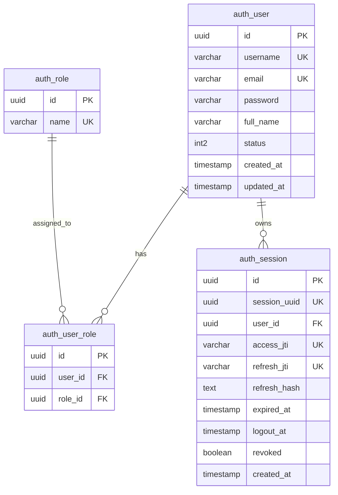

# RBAC (Role-Based Access Control) API - Golang

RESTful API backend otentikasi dan otorisasi berbasis peran (**Role-Based Access Control / RBAC**) yang dibangun menggunakan **Golang**, **Gin Web Framework**, **PostgreSQL** (*pgx*), **Bcrypt**, dan **JSON Web Token (JWT)**.

---

## 🚀 Fitur Utama

- **Authentication (Autentikasi):**
  - Registrasi user baru dengan enkripsi password menggunakan **Bcrypt**.
  - Login dengan penerbitan sepasang token: **Access Token** (masa berlaku pendek) & **Refresh Token** (masa berlaku panjang).
  - Penyematan identitas user (`userID`, `sessionUUID`, dan `role`) ke dalam payload JWT.
- **Authorization & RBAC (Otorisasi Berbasis Peran):**
  - **`RequireAuth` Middleware:** Memvalidasi stempel digital JWT (HS256), memeriksa waktu kedaluwarsa, dan mengekstrak klaim pengguna ke dalam context request.
  - **`RequireRole` Middleware:** Membatasi akses endpoint hanya untuk role tertentu (misal: khusus `Admin`, khusus `User`, atau kombinasi keduanya).
  - Skema database relasional multi-tabel (`auth_user`, `auth_role`, `auth_user_role`).
  - Fitur **Assign Role** khusus Admin untuk mengubah hak akses user lain.
- **Clean Architecture & Maintainability:**
  - Pemisahan lapisan yang jelas antara *Domain/DTO*, *Repository (Database)*, *Usecase (Business Logic)*, *Handler (HTTP)*, dan *Middleware*.
  - Unit test otomatis untuk middleware, usecase, dan token manager.

---

## 🛠️ Tech Stack & Library

* **Bahasa Pemrograman:** [Go (Golang)](https://go.dev/)
* **HTTP Framework:** [Gin Gonic](https://github.com/gin-gonic/gin)
* **Database & Driver:** PostgreSQL dengan [pgx/v5](https://github.com/jackc/pgx) (Connection Pool)
* **Database Migration:** [golang-migrate](https://github.com/golang-migrate/migrate)
* **JWT:** [golang-jwt/jwt/v5](https://github.com/golang-jwt/jwt)
* **Password Hashing:** [golang.org/x/crypto/bcrypt](https://pkg.go.dev/golang.org/x/crypto/bcrypt)
* **UUID:** [google/uuid](https://github.com/google/uuid)

---

## 📁 Struktur Direktori

```text
rbac/
├── cmd/
│   ├── api/
│   │   └── main.go          # Titik masuk utama aplikasi (server runner & dependency injection)
│   └── migrate/
│       └── main.go          # Runner migrasi skema tabel database
├── config/
│   └── config.go            # Pengelola variabel lingkungan (.env)
├── internal/
│   ├── httpserver/          # Wrapper kustom untuk HTTP Server & Gin router
│   ├── middleware/          # Middleware keamanan (RequireAuth & RequireRole)
│   └── modules/
│       └── auth/
│           ├── domain/      # Entity & DTO (User, Role, Session, Request/Response structs)
│           ├── handler/     # REST Handler (Register, Login, AssignRole)
│           ├── repository/  # Query PostgreSQL (auth_user, auth_role, auth_user_role)
│           ├── tokenhash/   # Generator hash SHA-256 untuk Refresh Token
│           └── usecase/     # Logika bisnis autentikasi & pendaftaran
├── migration/               # File migrasi SQL up & down (golang-migrate)
├── pkg/
│   ├── jwt/                 # Token Manager (penerbitan & verifikasi JWT)
│   └── password/            # Bcrypt hasher & comparator
├── server/
│   └── router.go            # Pendaftaran rute API & pembagian zona middleware
├── .env                     # Konfigurasi environment lokal
├── go.mod
└── README.md
```

---

## 🗄️ Skema Database



---

## ⚙️ Panduan Menjalankan Proyek

### 1. Konfigurasi Environment (`.env`)
Buat atau sesuaikan file `.env` di root direktori:

```env
APP_NAME=RBAC
APP_PORT=8080

DB_HOST=localhost
DB_PORT=5432
DB_USER=postgres
DB_PASWORD=root
DB_NAME=rbac
DB_SSLMODE=disable

JWT_SECRET=super-secret-rbac-key-ganti-di-production
```

### 2. Jalankan Migrasi Database
Perintah ini akan membuat database `rbac` (jika belum ada) dan mengeksekusi tabel-tabel migrasi beserta seed data default (`Admin` & `User`):

```powershell
go run cmd/migrate/main.go
```

### 3. Jalankan Server API
```powershell
go run cmd/api/main.go
```
Server akan berjalan di `http://localhost:8080`.

### 4. Menjalankan Unit Test
```powershell
go test -v ./...
```

---

## 📖 Dokumentasi Endpoint API

Base URL: `http://localhost:8080`

### 1. Zona Public (Tanpa Token)

#### A. Registrasi User Baru
* **URL:** `POST /api/v1/auth/register`
* **Request Body:**
  ```json
  {
    "username": "budi_santoso",
    "email": "budi@example.com",
    "password": "password123",
    "full_name": "Budi Santoso",
    "role": "User"
  }
  ```
* **Response (201 Created):**
  ```json
  {
    "status": "success",
    "message": "Registrasi berhasil",
    "data": {
      "user": {
        "id": "7ca64fd3-bc8d-4f51-b956-62111d4d8e7b",
        "username": "budi_santoso",
        "email": "budi@example.com",
        "full_name": "Budi Santoso",
        "role": "User",
        "status": 1,
        "created_at": "2026-10-22T14:00:00Z"
      },
      "tokens": {
        "access_token": "eyJhbGciOi...",
        "refresh_token": "eyJhbGciOi...",
        "token_type": "Bearer",
        "expires_in": 900
      }
    }
  }
  ```

#### B. Login
* **URL:** `POST /api/v1/auth/login`
* **Request Body:**
  ```json
  {
    "email": "budi@example.com",
    "password": "password123"
  }
  ```
* **Response (200 OK):**
  Mengembalikan data user beserta sepasang token JWT (`access_token` dan `refresh_token`).

---

### 2. Zona Terproteksi (Wajib Header `Authorization: Bearer <token>`)

#### C. Lihat Profil Sendiri (Semua Role)
* **URL:** `GET /profile`
* **Headers:** `Authorization: Bearer <access_token>`
* **Response (200 OK):**
  ```json
  {
    "message": "Ini profil Anda",
    "user_id": "7ca64fd3-bc8d-4f51-b956-62111d4d8e7b",
    "role": "User",
    "session_uuid": "3fa85f64-5717-4562-b3fc-2c963f66afa6"
  }
  ```

#### D. Penugasan / Ubah Role User (Khusus Admin)
* **URL:** `POST /api/v1/auth/assign-role`
* **Headers:** `Authorization: Bearer <token_admin>`
* **Request Body:**
  ```json
  {
    "user_id": "7ca64fd3-bc8d-4f51-b956-62111d4d8e7b",
    "role_id": "a0000000-0000-0000-0000-000000000001"
  }
  ```
* **Response (200 OK):** Mengembalikan data user yang rolenya sudah diperbarui.
* **Jika Diakses oleh User Biasa (403 Forbidden):**
  ```json
  {
    "status": "forbidden",
    "message": "Akses ditolak: Anda tidak memiliki role yang diizinkan untuk mengakses resource ini",
    "required_roles": ["Admin"],
    "your_role": "User"
  }
  ```

#### E. Hapus User (Khusus Admin)
* **URL:** `DELETE /users/:id`
* **Headers:** `Authorization: Bearer <token_admin>`
* **Response (200 OK):**
  ```json
  {
    "status": "success",
    "message": "User dengan ID 123 berhasil dihapus oleh Admin"
  }
  ```

---

## 🛡️ Cara Kerja Middleware RBAC

1. **`RequireAuth(tokenManager)`**:
   - Membaca header `Authorization: Bearer <token>`.
   - Memvalidasi keaslian signature HS256 dan memastikan token belum kedaluwarsa.
   - Memasukkan data klaim ke context request Gin:
     ```go
     c.Set("userID", claims.Subject)
     c.Set("role", claims.Role)
     c.Set("sessionUUID", claims.SessionUUID)
     ```
2. **`RequireRole(allowedRoles ...string)`**:
   - Mengambil data role dari context (`c.Get("role")`).
   - Mencocokkan apakah role user termasuk di dalam parameter `allowedRoles`.
   - Jika cocok $\rightarrow$ `c.Next()` dipanggil (lanjut ke handler).
   - Jika tidak cocok $\rightarrow$ Request langsung diputus dengan status HTTP **403 Forbidden**.
